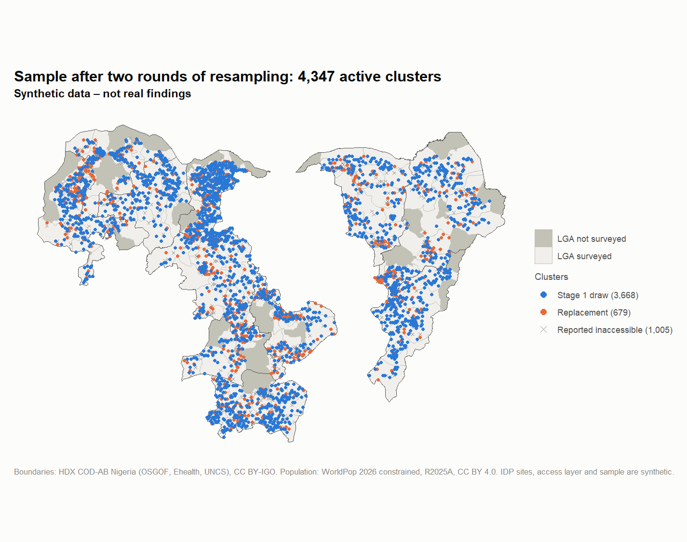
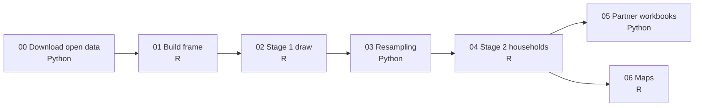
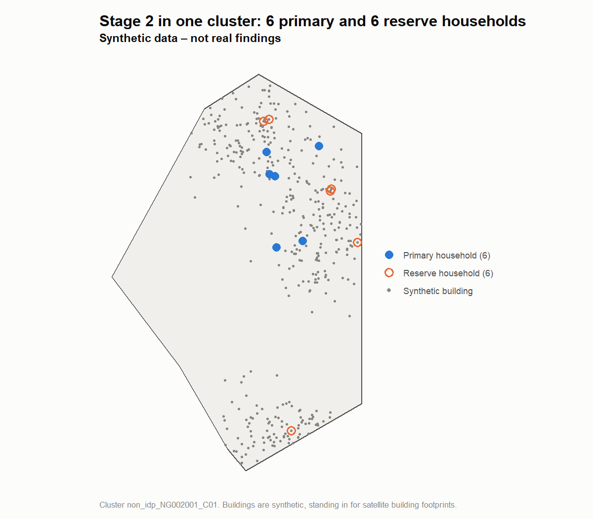

# MSNA sampling

Stage 1 of the [MSNA pipeline](https://github.com/JackPhilpott/msna-pipeline): drawing a two-stage
cluster sample of households for a large humanitarian survey, then redrawing it when places turn
out to be unreachable.

This is a public, runnable version of the sampling I built for the 2026 northern Nigeria
Multi-Sector Needs Assessment (MSNA). The real survey covers 32,000 households across 11 states and
176 local government areas (LGAs). It runs with 20+ partner organisations, at up to 1,000
submissions a day. Field teams cannot always reach every selected cluster, so the sample has to be
redrawn while data collection runs, without breaking the design. This repo runs the same design
from start to end, on open population data with a synthetic access layer and synthetic partners.

<picture>
  <source media="(prefers-color-scheme: dark)" srcset="docs/img/map_sample_dark.png">
  
</picture>

## What it does

| Step | Result in the demo run |
| :- | :- |
| Sampling frame | 22,509 hexagon pieces with households from WorldPop, plus 490 synthetic IDP sites, across 11 states and 233 LGAs |
| Access | A synthetic access layer leaves 186 LGAs where data collection is possible |
| Stage 1 | 310 strata (LGA × IDP or non-IDP), 4,632 clusters, 27,792 households |
| Resampling | Two rounds of partner reports: 1,005 clusters reported inaccessible, 720 replaced, 285 that could not be replaced |
| Stage 2 | 6 primary and 6 reserve households for each of the 4,347 active clusters: 52,164 households |
| Partner outputs | One Excel workbook per partner, "Partner A" to "Partner T" |

## How it works

The pipeline alternates between R and Python, as the real one did. Each step reads the previous
step's output from `data/synthetic/`.



**Frame.** The area is covered with 5 km hexagons, cut at LGA boundaries so that each piece sits in
one LGA. Each piece is a primary sampling unit (PSU) for the non-IDP population, with households
estimated from WorldPop. For the IDP population, each IDP site is a PSU.

**Access.** A band along the international border and a set of randomly placed zones are treated as
inaccessible and left out of the frame. An LGA with less than 30% of its households accessible is
not surveyed.

**Sample size.** Each LGA and population group (IDP or non-IDP) is a stratum. Every stratum gets
the standard two-stage cluster-survey sample size:
- 90% confidence, a 10% margin of error and an expected proportion of 0.5
- a design effect from an intra-cluster correlation of 0.06 and clusters of 6 households
- a finite-population correction, plus 10% for attrition, rounded up to whole clusters

A stratum with fewer than 36 households takes every PSU instead.

**Stage 1.** Clusters are drawn by systematic sampling with probability proportional to size, from
a random start along the frame in geographic order. The seed is fixed, so the draw is
reproducible. A large PSU can hold more than one cluster.

**Resampling.** In each round, every partner reports which of its clusters its teams cannot reach.
When a place is unreachable, all the clusters in it go together. Each lost cluster is replaced by a
new draw from what is left of its stratum: accessible PSUs that are not already selected and have
not been reported inaccessible. When a stratum runs out of PSUs, the gap is logged as a shortfall.
Shortfalls happen mostly in IDP strata, where there are few sites to draw from.

**Stage 2.** Each active cluster gets 6 primary and 6 reserve households, drawn at random from
synthetic buildings in its hexagon, or from dwellings around its IDP site.

<picture>
  <source media="(prefers-color-scheme: dark)" srcset="docs/img/stage2_example_dark.png">
  
</picture>

The R and Python steps each implement the same systematic PPS rule, and both are unit-tested.
Integrity tests also check the outputs. For example, every PSU must lie inside its own LGA, every
replacement must stay in its stratum, and every cluster must have exactly 6 + 6 households.

### Simplified from the real pipeline

- **Buildings:** the real stage 2 drew households from satellite building footprints. Here the
  buildings are synthetic.
- **IDP households:** real IDP household selection used listing procedures that differ between camps
  and host communities. Here households are drawn at random around the site.
- **Population data:** WorldPop at 1 km instead of 100 m. It's the same release, 4 MB instead of
  151 MB, and makes little difference for 5 km hexagons.
- **Left out:** the partner field packages (cluster maps, KML files, factsheets), the daily frame
  refresh and the Kobo integration.

## Quick start

You need R (4.4 or later) and Python (3.11 or later).

```bash
git clone https://github.com/JackPhilpott/msna-sampling.git
cd msna-sampling
Rscript -e "renv::restore()"                 # renv installs itself on first start
python -m venv .venv
.venv/bin/pip install -r requirements.txt    # Windows: .venv\Scripts\pip install -r requirements.txt
.venv/bin/python run_all.py                  # Windows: .venv\Scripts\python run_all.py
```

The first run downloads about 14 MB of open data, then takes about 5 minutes. Later runs are
quicker, because step 1 caches its slowest part in `data/interim/`. `python run_all.py 3` reruns
from step 3 onwards. The seed is fixed, so every run gives byte-identical outputs. All settings are in `config.yml`, including the
seed, the states, the hexagon size, the sample-size parameters, the access layer and the
resampling rates.

To run the tests:

```bash
Rscript -e "testthat::test_dir('tests/testthat')"
.venv/bin/python -m pytest tests/python
```

## Outputs

Everything in `data/synthetic/` is committed, so you can inspect the outputs without running
anything. The next stage, `msna-monitoring`, copies these files into
`data/synthetic/from_sampling/`.

| File | What it holds |
| :- | :- |
| `frame_psus.csv` | Every PSU (hexagon piece or IDP site): households, accessibility, coordinates |
| `lgas.csv` | Each LGA: households, accessible share, whether it is surveyed, partner |
| `idp_sites_synthetic.csv` | The synthetic IDP sites |
| `access_layer_synthetic.geojson` | The synthetic inaccessible area (GitHub shows it as a map) |
| `strata.csv` | Each stratum's size and number of clusters |
| `clusters.csv` | The stage 1 draw |
| `accessibility_reports/` | Each partner's report, per round |
| `clusters_after_resampling.csv` | Every cluster with its status, the round it was added or removed, and what it replaces |
| `resample_log.csv` | Per stratum and round: clusters reported inaccessible, replaced, and shortfall |
| `households/` | The household lists, one file per state |
| `partner_workbooks/` | One workbook per partner: summary, clusters, households, resampling history |

## Data and confidentiality

No real survey data is used. That means no real sampling frames, partner details, IDP site names or
locations, or security data. The only real data is open data, which is downloaded by script and not
committed:

- **Boundaries:** Nigeria Subnational Administrative Boundaries (COD-AB), from the Office of the
  Surveyor General of the Federation (OSGOF), Ehealth and the UN Cartographic Section, via
  [HDX](https://data.humdata.org/dataset/cod-ab-nga). Licence:
  [CC BY-IGO](https://creativecommons.org/licenses/by/3.0/igo/).
- **Population:** WorldPop, Bondarenko M. et al. (2025), *Constrained estimates of 2015–2030 total
  number of people per grid square*, release R2025A v1, University of Southampton,
  [doi:10.5258/SOTON/WP00839](https://doi.org/10.5258/SOTON/WP00839). Licence:
  [CC BY 4.0](https://creativecommons.org/licenses/by/4.0/).

The 11 states are the real ones covered by the survey, because state and LGA names are public.
Which LGAs are surveyed is decided by the synthetic access layer, not by the real list, so this repo
says nothing about real access or security. The IDP sites, access layer, partners, accessibility
reports, buildings and households are all synthetic, made by seeded scripts. Every map and
workbook carries the label "Synthetic data – not real findings".

Before every commit, the repo is checked against a private deny-list of names, contacts, internal
paths and site names. It is also scanned for secrets with gitleaks, checked so that no file matches
a real data file, and kept to files under 2 MB.

## Part of the MSNA pipeline

| Stages | Repo | Status |
| :- | :- | :- |
| Overview | [`msna-pipeline`](https://github.com/JackPhilpott/msna-pipeline) | Live |
| 1 | `msna-sampling` (this repo) | Live |
| 2–3 | `msna-monitoring`: field monitoring, cleaning and validity checks | Planned |
| 4–5 | `msna-results`: analysis and reporting | Planned, mid-Nov 2026 |

---

Built with AI-assisted development, reviewed and tested by me.
